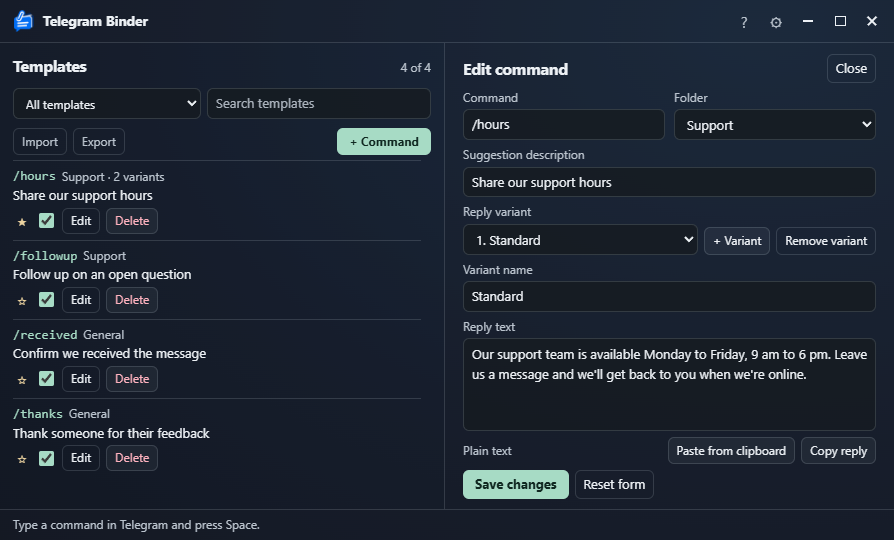

<p align="center"></p>
<h1 align="center">Telegram Binder</h1>
<p align="center" dir="rtl"><strong>ابزار پاسخ سریع برای تلگرام دسکتاپ در ویندوز</strong></p>
<p align="center"><a href="https://github.com/AkumaHacai/telegram-binder-desktop/releases/latest"><strong>دانلود برای ویندوز</strong></a> · <a href="README.md">English</a> · <a href="README.ru.md">Русский</a> · <a href="README.zh.md">简体中文</a></p>

الگوهای پیام را ذخیره کنید و با یک فرمان کوتاه در پیش‌نویس تلگرام بگذارید. برای نمونه، `/hours` را بنویسید و کلید فاصله را بزنید تا ساعت کاری پشتیبانی درج شود. وقتی پیام آماده بود، خودتان آن را بفرستید.



## دانلود برای ویندوز

| نسخهٔ ویندوز | دانلود |
| --- | --- |
| x64 (بیشتر رایانه‌های Intel و AMD) | [TelegramBinder-win-x64.exe](https://github.com/AkumaHacai/telegram-binder-desktop/releases/latest/download/TelegramBinder-win-x64.exe) |
| x86 (ویندوز ۳۲ بیتی) | [TelegramBinder-win-x86.exe](https://github.com/AkumaHacai/telegram-binder-desktop/releases/latest/download/TelegramBinder-win-x86.exe) |
| ARM64 (ویندوز روی Arm) | [TelegramBinder-win-arm64.exe](https://github.com/AkumaHacai/telegram-binder-desktop/releases/latest/download/TelegramBinder-win-arm64.exe) |

فایل `.exe` را در کنار تلگرام دسکتاپ اجرا کنید. فایل دانلودی شامل ‎.NET است و برای اجرا به [Microsoft Edge WebView2 Runtime](https://developer.microsoft.com/microsoft-edge/webview2/) نیاز دارد.

## روش استفاده

1. در Binder روی **+ فرمان** بزنید، دستور و متن پاسخ را وارد کنید و روی **ایجاد فرمان** بزنید. برای هر دستور می‌توانید چند پاسخ ذخیره کنید.
2. در گفت‌وگوی تلگرام دستور را بنویسید و کلید فاصله را بزنید. هر سه پیشوند `/`، `.` و `!` قابل استفاده‌اند.
3. اگر فهرست پیشنهادها یا پاسخ‌ها باز شد، با کلیدهای جهت‌دار انتخاب کنید و Tab یا Enter را بزنید. می‌توانید روی گزینه هم کلیک کنید. Esc فهرست را می‌بندد.

در کادر پیام تلگرام Ctrl+Shift+B را بزنید تا کل پیش‌نویس در پاسخی که در Binder ویرایش می‌کنید کپی شود. چسباندن ایموجی سفارشی به تلگرام بستگی دارد. فهرست‌های HTML در نسخه‌های پشتیبان وب به صورت متن همراه با نشانه‌های فهرست چسبانده می‌شوند.

با بستن پنجره، Binder در ناحیهٔ اعلان ویندوز می‌ماند. از فیلتر کنار جست‌وجو برای دیدن پوشه‌ها و موارد دلخواه استفاده کنید. در تنظیمات می‌توانید پوشه‌ها را مدیریت کنید و زبان را به فارسی، روسی، انگلیسی یا چینی ساده تغییر دهید. دکمهٔ **?** راهنما را باز می‌کند.

**درون‌ریزی** پشتیبان‌های JSON نسخهٔ v1 و v2 را می‌خواند و پس از تأیید، جایگزین الگوهای فعلی می‌کند. **برون‌ریزی** یک نسخهٔ پشتیبان JSON ذخیره می‌کند. الگوها در `%LOCALAPPDATA%\TelegramBinderDesktop\templates.json` ذخیره می‌شوند.

## ساخت از روی کد منبع

در ویندوز ‎.NET 10 SDK را نصب کنید و این دستور را در پوشهٔ اصلی مخزن اجرا کنید.

```powershell
dotnet publish -c Release -r win-x64 --self-contained true -p:PublishSingleFile=true -p:IncludeNativeLibrariesForSelfExtract=true -p:EnableCompressionInSingleFile=true -p:DebugType=None -o artifacts/win-x64
```

برای معماری‌های دیگر از `win-x86` یا `win-arm64` استفاده کنید. برنامه را با `--self-test` اجرا کنید تا تطبیق دستورها و قالب‌های کلیپ‌بورد بررسی شوند.

[اطلاعیه‌های نرم‌افزارهای شخص ثالث](THIRD-PARTY-NOTICES.txt)
