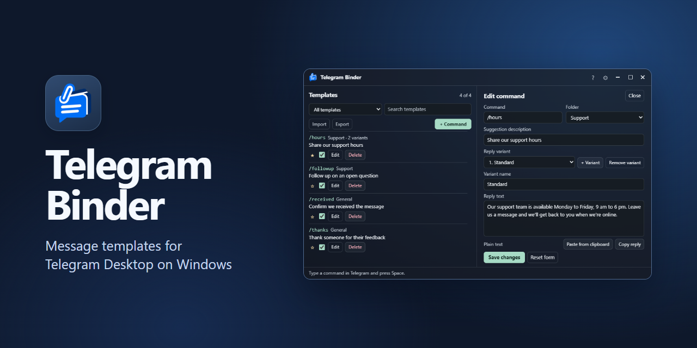

<h1 align="center">Telegram Binder</h1>
<p align="center"><strong>Text expander for Telegram Desktop on Windows</strong></p>
<p align="center"><a href="https://github.com/AkumaHacai/telegram-binder-desktop/releases/latest"><strong>Download for Windows</strong></a> · <a href="README.ru.md">Русский</a> · <a href="README.zh.md">简体中文</a> · <a href="README.fa.md">فارسی</a></p>

Save message templates and insert them into a Telegram draft with a short command. Type `/hours` and press Space to insert your support hours. You send the message from Telegram when it’s ready.



## Download for Windows

Pick the executable for your Windows system.

| Windows | Download |
| --- | --- |
| x64 (most Intel and AMD PCs) | [TelegramBinder-win-x64.exe](https://github.com/AkumaHacai/telegram-binder-desktop/releases/latest/download/TelegramBinder-win-x64.exe) |
| x86 (32-bit Windows) | [TelegramBinder-win-x86.exe](https://github.com/AkumaHacai/telegram-binder-desktop/releases/latest/download/TelegramBinder-win-x86.exe) |
| ARM64 (Windows on Arm) | [TelegramBinder-win-arm64.exe](https://github.com/AkumaHacai/telegram-binder-desktop/releases/latest/download/TelegramBinder-win-arm64.exe) |

Run the `.exe` alongside Telegram Desktop. The download includes .NET and requires [Microsoft Edge WebView2 Runtime](https://developer.microsoft.com/microsoft-edge/webview2/).

## Insert a saved reply

1. Click **+ Command**, enter a command and a reply, then click **Create command**. You can add several replies to the same command.
2. In a Telegram chat, type the command and press Space. The prefixes `/`, `.` and `!` work interchangeably.
3. When suggestions or variants appear, use the arrow keys and press Tab or Enter. You can also click a row. Esc closes the list.

[See the full-size template editor](docs/media/telegram-binder-editor.png).

Press Ctrl+Shift+B in Telegram's message box to copy the draft into the variant you're editing in Binder. Telegram controls whether custom emoji can be pasted. HTML lists from Web backups paste as text with list markers.

Binder stays in the system tray when you close its window. Use the filter next to search to browse favorites or folders. Open Settings to manage folders or switch between Russian, English, Simplified Chinese and Persian. The **?** button opens the help guide.

**Import JSON** restores a v1 or v2 Binder backup and replaces the current library after confirmation. **Export JSON** saves a backup. Templates are stored in `%LOCALAPPDATA%\TelegramBinderDesktop\templates.json`.

## Build

On Windows with the .NET 10 SDK, run this from the repository root.

```powershell
dotnet publish -c Release -r win-x64 --self-contained true -p:PublishSingleFile=true -p:IncludeNativeLibrariesForSelfExtract=true -p:EnableCompressionInSingleFile=true -p:DebugType=None -o artifacts/win-x64
```

Use `win-x86` or `win-arm64` for the other builds. Pass `--self-test` to the executable to check command matching and clipboard formats.

[Third-party notices](THIRD-PARTY-NOTICES.txt)
