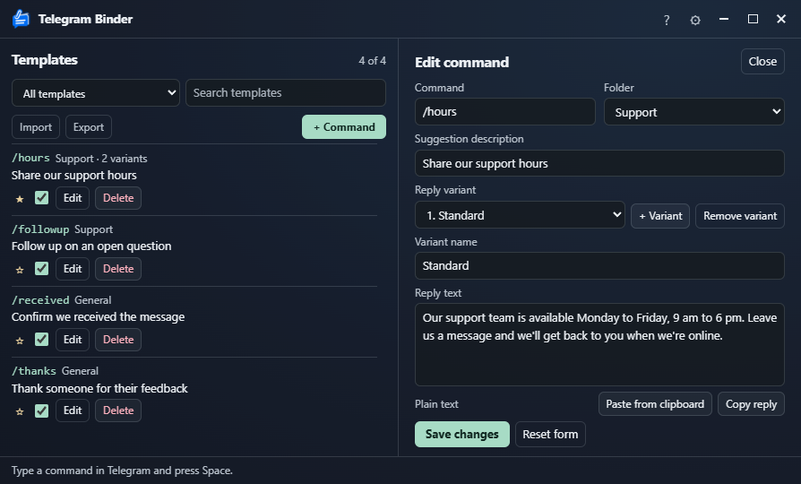

<p align="center"></p>
<h1 align="center">Telegram Binder</h1>
<p align="center"><strong>适用于 Windows 版 Telegram Desktop 的快捷回复工具</strong></p>
<p align="center"><a href="https://github.com/AkumaHacai/telegram-binder-desktop/releases/latest"><strong>下载 Windows 版</strong></a> · <a href="README.md">English</a> · <a href="README.ru.md">Русский</a> · <a href="README.fa.md">فارسی</a></p>

保存常用消息模板，再用短命令把回复插入 Telegram 草稿。例如，输入 `/hours` 后按空格，即可插入客服工作时间。准备好后，由你发送消息。



## 下载 Windows 版

| Windows | 下载 |
| --- | --- |
| x64（大多数 Intel 和 AMD 电脑） | [TelegramBinder-win-x64.exe](https://github.com/AkumaHacai/telegram-binder-desktop/releases/latest/download/TelegramBinder-win-x64.exe) |
| x86（32 位 Windows） | [TelegramBinder-win-x86.exe](https://github.com/AkumaHacai/telegram-binder-desktop/releases/latest/download/TelegramBinder-win-x86.exe) |
| ARM64（Arm 版 Windows） | [TelegramBinder-win-arm64.exe](https://github.com/AkumaHacai/telegram-binder-desktop/releases/latest/download/TelegramBinder-win-arm64.exe) |

同时运行下载的 `.exe` 和 Telegram Desktop。下载的程序已包含 .NET，需要 [Microsoft Edge WebView2 Runtime](https://developer.microsoft.com/microsoft-edge/webview2/)。

## 使用

1. 在 Binder 里点击 **+ 命令**，输入指令和回复后点击 **创建命令**。一条指令可以有多种回复。
2. 在 Telegram 聊天里输入指令，再按空格。`/`、`.` 和 `!` 都可以用作前缀。
3. 出现建议或回复选项时，用方向键选择，再按 Tab 或 Enter，也可以直接点击。按 Esc 关闭列表。

在 Telegram 输入框里按 Ctrl+Shift+B，可以把整段草稿复制到 Binder 正在编辑的回复里。自定义表情能否粘贴取决于 Telegram。网页端备份中的 HTML 列表会以带列表标记的纯文本粘贴。

关闭窗口后，Binder 会留在系统托盘。用搜索框旁的筛选器查看收藏或文件夹。设置中可以管理文件夹，并切换俄语、英语、简体中文或波斯语。点击 **?** 查看帮助。

**导入**支持 v1 和 v2 的 JSON 备份，确认后会替换现有模板。**导出**会保存 JSON 备份。模板存放在 `%LOCALAPPDATA%\TelegramBinderDesktop\templates.json`。

## 从源码构建

在 Windows 上安装 .NET 10 SDK，然后在仓库根目录执行下列命令。

```powershell
dotnet publish -c Release -r win-x64 --self-contained true -p:PublishSingleFile=true -p:IncludeNativeLibrariesForSelfExtract=true -p:EnableCompressionInSingleFile=true -p:DebugType=None -o artifacts/win-x64
```

构建其他版本时，将目标改为 `win-x86` 或 `win-arm64`。运行程序时加上 `--self-test`，可以检查指令匹配和剪贴板格式。

[第三方声明](THIRD-PARTY-NOTICES.txt)
